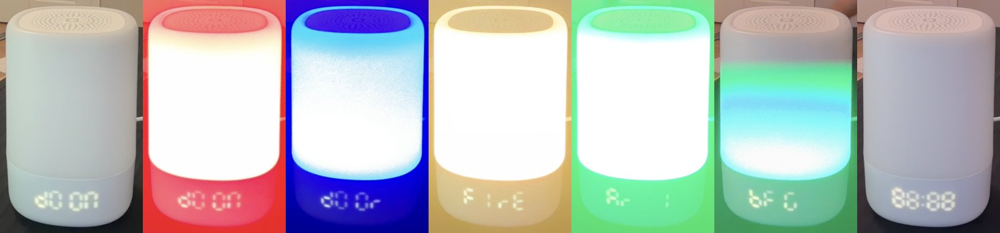

# knee-deep-in-the-crib

Custom firmware for the Nanit Light & Sound, a nursery night light, sound machine and
clock. Instead of white noise and a gentle glow, it plays the E1M1 riff from DOOM as a
chiptune and flashes red on the beat, with "dOOM" on the clock. Between loops come a few
seconds of shotgun, imp fireball and BFG, each with its own lights.



From power-on it loops forever:

1. **The song** (about 18 s): "dOOM" scrolls onto the clock and the lamp flashes red on
   every kick and snare.
2. **The interlude** (about 9 s), all synthesized:

   | effect | lamp | clock |
   |---|---|---|
   | door | blue | `dOOr` |
   | two pistol shots | yellow muzzle flashes | |
   | imp fireball | flickering red and orange | `FIrE` |
   | shotgun, then the pump | white flash | `SHOt` |
   | armor pickup | green | `Ar 1` |
   | BFG charge and blast | green, blinking faster, then everything at once | `bFG`, `88:88` |

The top button starts the song over.

No Nanit code ships here. The pin map and protocols were worked out from the stock
firmware and then confirmed on the device; the write-up is in
[docs/HARDWARE.md](docs/HARDWARE.md).

## Hardware

A Nanit Light & Sound (ESP32-S3-WROOM-1U) and a USB-C data cable. Nothing gets opened
or soldered.

## Before you flash: back up the stock firmware

The stock flash holds your unit's pairing keys and Wi-Fi settings, and this is the only
way back to a working Nanit. Keep the dump private and keep a second copy.

Stock firmware turns USB off once it boots, so the first time you need ROM download
mode: **hold the top button while plugging in USB-C** (if the battery is in, switch the
unit off first so it actually powers up). It shows up as "USB JTAG/serial debug unit".

```sh
pip install esptool
esptool --port /dev/cu.usbmodem101 --before no-reset --after no-reset read-flash 0 0x1000000 nanit-backup.bin
esptool --port /dev/cu.usbmodem101 --before no-reset --after no-reset verify-flash 0 nanit-backup.bin
```

Don't pass `--baud`; the USB-Serial-JTAG link breaks when esptool tries to change it.

## Build and flash

Needs [ESP-IDF v5.2](https://docs.espressif.com/projects/esp-idf/en/v5.2.2/esp32s3/get-started/).
`esp_codec_dev` comes in through the component manager.

```sh
cd firmware
idf.py set-target esp32s3
idf.py build
esptool --port /dev/cu.usbmodem101 --before default-reset --after hard-reset \
  write-flash --flash-mode dio --flash-size 16MB --flash-freq 80m \
  0x0 build/bootloader/bootloader.bin \
  0x8000 build/partition_table/partition-table.bin \
  0x10000 build/knee_deep_in_the_crib.bin
```

Use esptool directly rather than `idf.py flash`, which passes a baud rate. This firmware
keeps USB up, so later flashes need no button.

To go back to stock, put the unit in download mode and write the backup to 0x0.

## Console

The firmware keeps a USB serial console. `tools/con.py` talks to it without resetting
the chip:

```sh
python tools/con.py "text 1337" "lamp 0 1 0 0" "sfx bfg"
```

| command | does |
|---|---|
| `play`, `stop` | start the loop over, or stop it |
| `sfx shotgun\|pistol\|imp\|pickup\|door\|bfg` | play one effect (no argument: the whole interlude) |
| `text abcd`, `disp <hex>`, `bright 0-7` | write to the clock |
| `lamp r g b w` | set the lamp (each 0 or 1) |
| `vol 0-100`, `tone <hz> <ms>` | audio |
| `led <gpio> <duty>`, `gpio <n> <0\|1>`, `i2c` | poke at the hardware |

## Tools

`tools/` holds what was used to find the hardware and check the result: an OpenOCD
client and live GPIO-matrix dump (`ocd.py`, `gpiodump.py`), string and literal
cross-references for your own firmware dump (`xref.py`), and camera and microphone
checks (`look.sh`, `nudge`, `camsnap`, `audio_check.py`, plus the `*test.py` sweeps).

## Legal

For hardware you own. It will void your warranty, and the unit stops working with
Nanit's app and service until you restore your backup.

Nothing here bypasses a protection: the chip ships with flash encryption and secure boot
off, and the dump uses the ESP32-S3's ordinary download mode. Don't publish your dump.
It's Nanit's copyrighted firmware, and it holds your device's secrets.

Not affiliated with Nanit or id Software. DOOM is a trademark of id Software. The E1M1
riff ("At Doom's Gate") was composed by Bobby Prince; it's rendered here as a short
chiptune tribute, and all sound effects are synthesized from scratch.

## License

[BSD 3-Clause](LICENSE).
